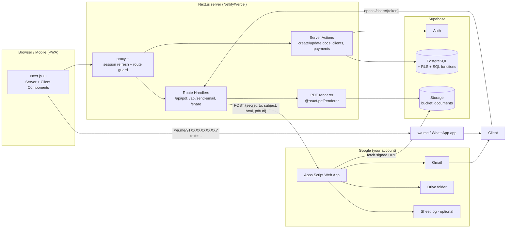
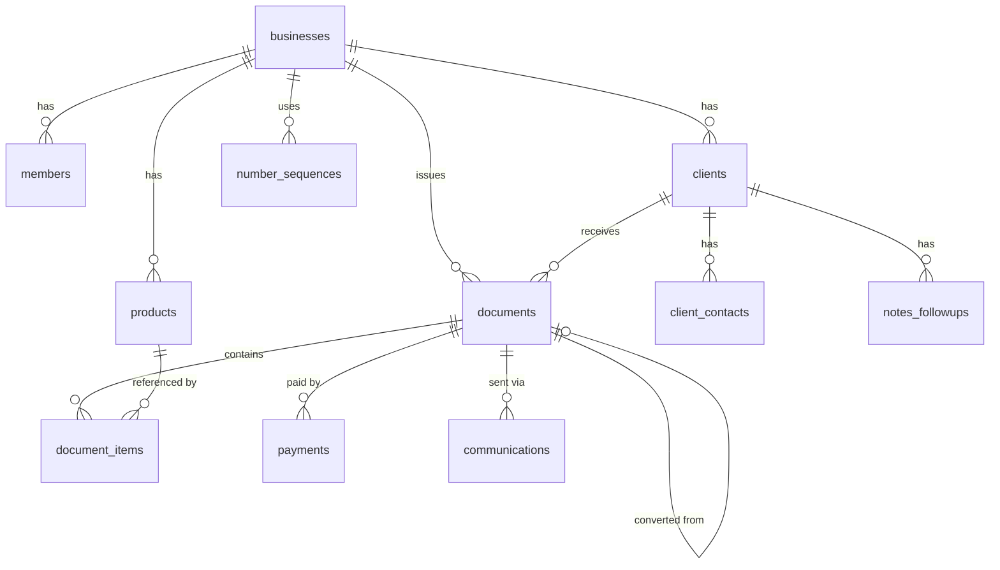
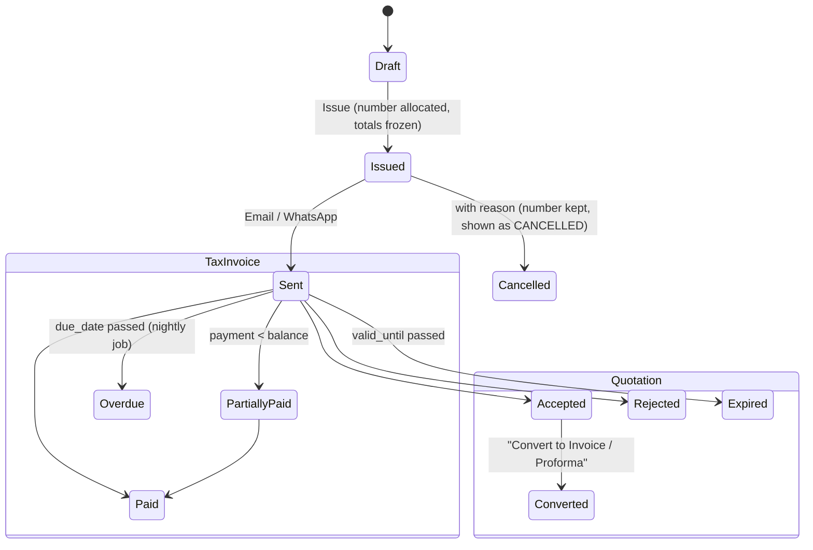
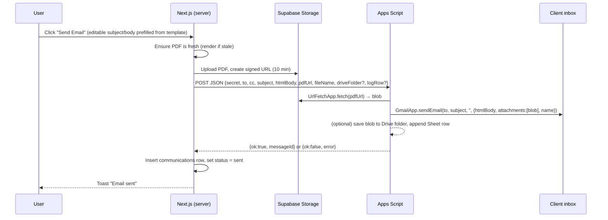

v # SmartBill CRM — Architecture

> Status: **v1 built** · Date: 2026-10-17 (see §15 for what changed during the build)
> Scope: replace the current SmartBill single-page billing tool with a CRM that manages clients, quotations, invoices, payments, email/WhatsApp delivery and monthly sales reporting.

---

## 1. Context: what exists today

The current app (`snbillsystemvicky.netlify.app`) is a Vite + React SPA. Analysis of its production bundle:

| Area      | Current behaviour                                                                                                                                                  |
| --------- | ------------------------------------------------------------------------------------------------------------------------------------------------------------------ |
| Access    | Single password screen; the password is a string compared **in the browser bundle**, unlock flag stored in `localStorage.isAuthorized`                             |
| Documents | `TAX INVOICE` or `PROFORMA INVOICE` (no quotation)                                                                                                                 |
| Seller    | Hard-coded: SN SAFETY SIGNAGES, Vasai East, Maharashtra, GSTIN, bank (Yes Bank), logo, signature, payment QR                                                       |
| Customer  | Name (auto-search), address, contact, state, GSTIN, email; optional **Ship To** (different address)                                                                |
| Items     | Product name (auto-search), HSN, qty, rate, amount                                                                                                                 |
| Tax       | `auto` → IGST 18 % if customer state ≠ seller state, else CGST 9 % + SGST 9 %; can be forced to IGST or CGST+SGST. Single fixed rate (18 %)                        |
| Extras    | **Add Courier/Freight Charges** checkbox + amount (added _after_ tax); **Auto-save to Drive** toggle; **New Invoice**; **Save & Print** (`window.print()`, A4 CSS) |
| Memory    | New customers/products saved to `localStorage` on Save & Print, merged with lists fetched from Google Apps Script                                                  |
| Cloud     | A Google Apps Script (GAS) web app logs the invoice to a Google Sheet, saves the PDF to Drive and emails the customer                                              |
| Numbering | `INV-<n>`; counter in `localStorage` (and a `nextInvoiceNo` from GAS)                                                                                              |
| Tool      | **Material Master Calc**: L × B in in/ft/m/yd/cm/mm → area in all units, rate per unit, final amount                                                               |

### Problems the new system must fix

1. **No real security.** Anyone can read the password from the public JS bundle, and the GAS URL is public and unauthenticated.
2. **Data lives in the browser.** Customers, products and the invoice counter are per-device, so two devices can issue duplicate invoice numbers.
3. **No client history.** There are no quotations, payment tracking, outstanding balances or reports.
4. **Tax is too rigid.** Only 18 % is supported, there is no round-off and no amount in words. Freight is never taxed, which may be wrong for your supplies (to be confirmed with your CA).
5. **Printing depends on the browser.** The PDF comes from the browser's print dialog, so it can't be attached to emails or shared on WhatsApp automatically.

---

## 2. Goals & non-goals

**Goals**

- Store clients centrally, with a full history (quotations, invoices, payments, messages).
- Flow: **Quotation → (Proforma) → Tax Invoice → Payment**, converting with one click.
- Generate the PDF on the server so the file is identical everywhere and can be attached automatically.
- Send by **email** through Google Apps Script, with the PDF attached and no manual steps.
- Send by **WhatsApp** without the WhatsApp Business API: one tap opens that client's chat with the message pre-filled (see §7.2 for how the PDF gets there).
- Provide a monthly sales report that is well organised and exportable (PDF / Excel).
- Keep every feature of the current app, including the screenshot features: freight charges, auto-save to Drive, New Invoice, Save & Print, and auto-remembering new customers/products.

**Non-goals (v1)**

- Multi-company / SaaS billing for other businesses. The schema is _ready_ for it through `business_id`, but there is no UI for it.
- E-invoicing (IRN/QR from the GST portal) and e-way bills. These are listed as future work.
- Inventory/stock management.

---

## 3. Tech stack

| Layer             | Choice                                                | Notes                                                                                                                                               |
| ----------------- | ----------------------------------------------------- | --------------------------------------------------------------------------------------------------------------------------------------------------- |
| Framework         | **Next.js 16** (App Router), React 19                 | Server Components by default; Server Actions for mutations; Route Handlers for PDF/webhooks. Uses `proxy.ts` (Next 16's rename of `middleware.ts`). |
| Language          | **TypeScript** (strict)                               | Shared types generated from the DB schema (`supabase gen types`)                                                                                    |
| Styling           | **Tailwind CSS v4**                                   | CSS-first config (`@theme` in `globals.css`), print styles for A4                                                                                   |
| DB / Auth / Files | **Supabase**: PostgreSQL, Auth, Storage               | Row Level Security on every table; `@supabase/ssr` for cookie sessions                                                                              |
| Validation        | **Zod**                                               | One schema shared by forms and Server Actions                                                                                                       |
| Forms             | React Hook Form + Zod resolver                        | For the large invoice editor with dynamic line items                                                                                                |
| PDF               | **@react-pdf/renderer** (server-side)                 | Pure Node with no headless Chrome, so it works on Netlify/Vercel functions                                                                          |
| Email             | **Google Apps Script** web app (`MailApp`/`GmailApp`) | Called from the server with a shared secret; also handles the Drive backup                                                                          |
| Charts            | Recharts                                              | Dashboard & report charts                                                                                                                           |
| Excel export      | SheetJS (`xlsx`)                                      | Monthly report download                                                                                                                             |
| Icons             | lucide-react                                          | Same as the current app                                                                                                                             |
| Hosting           | Netlify (current) or Vercel                           | Supabase hosted (Mumbai `ap-south-1` region for latency)                                                                                            |

---

## 4. High-level architecture



**Principles**

- **The database is the source of truth.** Google Sheets/Drive are only for backup and logging, never for reading data back.
- **Totals are computed on the server** by one pure function (`lib/tax/calculate.ts`), and the result is stored on the document. The browser uses the same function for the live preview, but the server recomputes on save.
- **Issued documents are immutable.** Once an invoice is _issued_, edits require cancelling it or issuing a credit note (GST compliance). Drafts are freely editable.
- **Secrets never reach the browser.** The GAS secret and the Supabase service-role key exist only in server code.

---

## 5. Data model (PostgreSQL)

### 5.1 ER overview



### 5.2 Tables

**`businesses`**: seller profile, replacing the hard-coded values.
`id, name, legal_name, address_line1, address_line2, city, state, state_code, pincode, gstin, pan, email, phone, logo_path, signature_path, payment_qr_path, upi_id, bank_account_name, bank_account_no, bank_ifsc, bank_name, bank_branch, default_terms text, invoice_footer, default_tax_rate numeric(5,2) default 18, round_off boolean default true, financial_year_start_month int default 4, created_at`

**`members`**: who can log in to the business.
`business_id, user_id → auth.users, role enum('owner','staff','viewer'), created_at` · PK `(business_id, user_id)`

**`clients`**
`id, business_id, name, company_name, gstin, pan, email, phone_e164 (e.g. 919876543210), whatsapp_e164 (defaults to phone), billing_address, billing_city, billing_state, billing_state_code, billing_pincode, shipping_* (same fields, nullable), tags text[], notes, credit_days int default 0, opening_balance numeric(14,2) default 0, is_archived bool, created_at, updated_at`
Index: `(business_id, lower(name))` unique where not archived; trigram index for search.

**`client_contacts`** _(optional extra people at a company)_: `id, client_id, name, designation, email, phone_e164`

**`products`**: replaces "product memory".
`id, business_id, name, description, hsn_sac, unit (pcs/sqft/nos/set/…), default_rate numeric(14,2), tax_rate numeric(5,2) default 18, pricing_mode enum('unit','area'), is_archived, created_at, updated_at`
Unique `(business_id, lower(name))`.

**`documents`**: one table for quotations, proformas, tax invoices and credit notes.
| Column | Type | Notes |
|---|---|---|
| `id` | uuid | |
| `business_id` | uuid | RLS key |
| `doc_type` | enum `quotation \| proforma \| tax_invoice \| credit_note` | |
| `status` | enum `draft \| issued \| sent \| accepted \| rejected \| expired \| partially_paid \| paid \| overdue \| cancelled \| converted` | allowed values depend on type (see §6) |
| `number` | text | e.g. `QT/26-27/0007`, `INV/26-27/0123`; null while draft |
| `fy` | text | `2026-27` |
| `issue_date`, `due_date`, `valid_until` | date | `valid_until` is for quotations |
| `client_id` | uuid | |
| `bill_to` / `ship_to` | jsonb | **snapshot** of the client address at issue time, so later edits to the client don't change old invoices |
| `place_of_supply_state_code` | text | drives the IGST vs CGST/SGST decision |
| `tax_mode` | enum `auto \| igst \| cgst_sgst` | same as the current app |
| `freight_amount` | numeric(14,2) | courier/freight charges (screenshot feature) |
| `freight_taxable` | bool | default per business setting |
| `discount_amount` | numeric(14,2) | document-level |
| `subtotal, taxable_value, cgst, sgst, igst, total_tax, round_off, grand_total` | numeric(14,2) | stored snapshot |
| `amount_paid` | numeric(14,2) | maintained by trigger from `payments` |
| `balance_due` | generated | `grand_total - amount_paid` |
| `notes, terms` | text | |
| `converted_from_id` | uuid → documents | quotation → invoice link |
| `share_token` | text unique | random, 32+ chars, for the public `/share/{token}` page |
| `pdf_path` | text | Storage path of the latest rendered PDF |
| `pdf_rendered_at` | timestamptz | the PDF is re-rendered when this is older than `updated_at` |
| `created_by, created_at, updated_at, issued_at, cancelled_at, cancel_reason` | | |

**`document_items`**
`id, document_id, position int, product_id (nullable), name, description, hsn_sac, unit, qty numeric(14,3), rate numeric(14,2), length, breadth, dimension_unit (for area pricing, from Material Calc), discount_pct, tax_rate, taxable_amount, cgst, sgst, igst, line_total`

**`payments`**
`id, business_id, document_id, client_id, amount, paid_on date, method enum('cash','upi','bank_transfer','cheque','card','other'), reference, notes, created_at`
A trigger updates `documents.amount_paid` and `status` (`partially_paid` / `paid`).

**`communications`**: the send log shown on the client timeline.
`id, document_id, client_id, channel enum('email','whatsapp'), to_address, subject, body, status enum('queued','sent','failed','opened_link'), error, created_by, created_at`
WhatsApp rows are logged when the user taps the button. WhatsApp itself can't confirm delivery.

**`followups`**: reminders/CRM notes.
`id, client_id, document_id (nullable), due_at, note, done boolean, created_by`

**`number_sequences`**
`business_id, doc_type, fy, prefix, next_value int` · PK `(business_id, doc_type, fy)`
The value is allocated **only when a document is issued**, by the SQL function `next_document_number(business_id, doc_type, date)` using `UPDATE … SET next_value = next_value + 1 RETURNING`. This is atomic, so two devices can't get the same number, and drafts don't burn numbers. The starting value can be set so numbering continues from the old app's last `INV-` number.

**`activity_log`**: `id, business_id, actor_id, entity, entity_id, action, diff jsonb, created_at` (audit trail).

### 5.3 Row Level Security

Every business-owned table gets:

```sql
using (business_id in (select business_id from members where user_id = auth.uid()))
```

`viewer` is read-only; `staff` can't delete or cancel issued invoices; `owner` can do everything. The public share page uses a **server-side** lookup by `share_token` with the service role and returns only that one document's PDF and summary, never the table.

### 5.4 Storage

Bucket `documents` (private). Path: `{business_id}/{doc_type}/{fy}/{number}.pdf`. Access is through **signed URLs** (short-lived, e.g. 10 min for GAS; generated on demand for the share page).
Bucket `branding` (private): logo, signature, payment QR.

### 5.5 Reporting views / functions

- `v_invoice_lines`: flattened issued tax-invoice lines with month, client, product, HSN, tax split.
- `monthly_sales_report(business_id, month date) returns jsonb`: every number for the report in one round trip (§8).
- `client_ledger(client_id, from, to)`: invoices, payments, credit notes and running balance.
- `receivables_aging(business_id, as_of)`: buckets 0–30, 31–60, 61–90, 90+.

---

## 6. Document lifecycle



- **Convert** copies the client, items, tax mode and freight into a new draft of the target type with `converted_from_id` set, and marks the quotation `converted`.
- **Duplicate** creates a new draft from any document (useful for repeat orders).
- A daily **overdue/expired** job runs through a Supabase `pg_cron` schedule, or a Netlify/Vercel scheduled function.

---

## 7. Sending documents

### 7.1 Email via Google Apps Script



- **Auth:** GAS verifies `secret` against a Script Property (`SHARED_SECRET`). The GAS URL and secret are server-only env vars (`GAS_WEBAPP_URL`, `GAS_SHARED_SECRET`), never shipped to the browser as they are today.
- **Why pass a URL and not base64?** It keeps the request small and avoids GAS payload limits. A base64 fallback is supported.
- **Quota:** GAS email limits are **100 recipients/day on a free Gmail account** and **1,500/day on Google Workspace**. That's enough for this business; the UI shows a clear error if the quota is exceeded.
- **Auto-save to Drive** (the screenshot toggle) reuses the same GAS endpoint with `action: "backup"`, which saves the PDF into `SmartBill/{FY}/{Month}/` in Drive. It's a per-document checkbox, with the default set in Settings.
- The repo will include the script as `gas/Code.gs`, with deploy instructions: Deploy → Web app → Execute as _Me_ → Access _Anyone_. The script itself rejects requests without the secret.

### 7.2 WhatsApp without the API

**A platform limitation you should know before approving.** WhatsApp's click-to-chat link (`https://wa.me/<number>?text=<message>`) can open a specific client's chat with a pre-filled message, but **no link can attach a file**. A file can be attached automatically only through the WhatsApp Business API (excluded here) or the device's share sheet (which can't pre-select a contact). So the design uses both, and you choose per tap:

| Option                      | What happens                                                                                                                                                                                    | Contact pre-selected?                 | PDF attached?                              | Works on                       |
| --------------------------- | ----------------------------------------------------------------------------------------------------------------------------------------------------------------------------------------------- | ------------------------------------- | ------------------------------------------ | ------------------------------ |
| **A. "WhatsApp" (default)** | Opens `wa.me/91XXXXXXXXXX?text=…` with a message that includes a **secure link to the PDF** (`https://yourapp/share/{token}`). The client taps the link to view or download the invoice.        | ✅ Yes                                | 🔗 As a link (no typing, no manual attach) | Desktop + mobile               |
| **B. "Share PDF" (mobile)** | Uses the Web Share API (`navigator.share({ files:[pdf], text })`). The phone's share sheet opens, you pick WhatsApp, then the client, and the **actual PDF file** is attached with the message. | ❌ You pick the chat (search by name) | ✅ Real file                               | Android Chrome, iOS Safari 15+ |

Option A meets the requirement "click → that client's chat, message ready, no typing, no manual attaching". The client receives a link that opens the invoice PDF in one tap. Option B is there for when you want the file itself inside WhatsApp.

Example pre-filled message (editable template in Settings):

```
Dear {client_name},
Please find your {doc_label} {number} dated {date} for ₹{grand_total}.
View / download: {share_url}
{payment_line}   ← e.g. "Pay via UPI: upi://pay?pa=…&am=…" when balance > 0
Thank you — SN Safety Signages
```

**The `/share/{token}` page** is public, needs no login, and is `noindex`. It shows a summary card, buttons to download the PDF and pay by UPI, and for quotations **Accept / Request changes** buttons that update the status and notify you. The link can be revoked from the document page by regenerating the token.

Phone numbers are stored in E.164 without the `+` (`919876543210`). Input accepts `98765 43210` and normalises it with an India default.

---

## 8. Monthly sales report

Route: `/reports/monthly?month=2026-10`. Server-rendered, printable as A4 and exportable to **PDF** and **Excel (.xlsx)**.

Sections:

1. **Headline KPIs:** total sales (grand total), taxable value, GST collected (CGST/SGST/IGST), freight, number of invoices, average invoice value, amount collected this month, outstanding at month end. Each shows the change vs the previous month and the same month last year.
2. **Daily sales chart** (bar) and a **6-month trend** line.
3. **Invoice register:** date, number, client, GSTIN, taxable value, CGST, SGST, IGST, freight, total, paid, balance, status. Sortable; cancelled invoices shown struck through and excluded from totals.
4. **Client-wise summary:** top clients by value, number of invoices, outstanding.
5. **Product/HSN-wise summary:** qty, taxable value and tax per HSN, in the GSTR-1 HSN-summary shape.
6. **GST summary:** B2B (with GSTIN) vs B2C, intra-state vs inter-state, tax-rate buckets. This is what your CA needs for GSTR-1/3B.
7. **Collections:** payments received in the month by method.
8. **Quotation funnel:** quotations sent → accepted → converted, and the conversion rate.

All figures come from the single SQL function `monthly_sales_report()`, so the screen, PDF and Excel always match. The Excel file has one sheet per section.

---

## 9. Application structure

### 9.1 Routes (App Router)

```
app/
  (auth)/login/page.tsx                 Supabase email+password / magic link
  (app)/layout.tsx                      Sidebar + top bar (mobile bottom nav)
  (app)/dashboard/page.tsx              KPIs, receivables, recent activity, follow-ups due
  (app)/clients/page.tsx                list, search, filters (tags, outstanding)
  (app)/clients/new/page.tsx
  (app)/clients/[id]/page.tsx           profile, timeline, documents, ledger, follow-ups
  (app)/quotations/page.tsx             list (status tabs)
  (app)/quotations/new/page.tsx         editor
  (app)/quotations/[id]/page.tsx        view + actions (send, convert, duplicate)
  (app)/invoices/page.tsx
  (app)/invoices/new/page.tsx           editor (same component, doc_type param)
  (app)/invoices/[id]/page.tsx          view + actions (send, record payment, cancel)
  (app)/payments/page.tsx
  (app)/products/page.tsx
  (app)/reports/monthly/page.tsx
  (app)/reports/receivables/page.tsx
  (app)/tools/area-calculator/page.tsx  Material Master Calc (ported)
  (app)/settings/{business,numbering,templates,integrations,team}/page.tsx
  share/[token]/page.tsx                public document page (no auth)
  api/documents/[id]/pdf/route.ts       GET → streams PDF (auth)
  api/share/[token]/pdf/route.ts        GET → streams PDF (token)
  api/reports/monthly/export/route.ts   GET ?format=xlsx|pdf
proxy.ts                                refresh Supabase session; redirect unauthenticated users from (app) to /login
```

### 9.2 Source layout

```
lib/
  supabase/{server.ts, client.ts, admin.ts}   SSR client, browser client, service-role (server-only)
  tax/calculate.ts                            pure totals engine (unit-tested)
  tax/amount-in-words.ts                      Indian numbering (lakh/crore)
  numbering.ts                                FY helpers (Apr–Mar), format templates
  pdf/DocumentPdf.tsx                         @react-pdf template (A4, same look as today)
  pdf/render.ts                               render → upload → return path
  messaging/email.ts                          GAS client (server-only)
  messaging/whatsapp.ts                       wa.me URL builder, template filling
  validation/*.ts                             Zod schemas
actions/                                      Server Actions ('use server'): clients, documents, payments, settings
components/
  document-editor/                            client form: party picker, line items, tax panel, freight, preview
  ui/                                         buttons, inputs, dialogs, combobox, table
gas/Code.gs                                   Apps Script source + README
supabase/migrations/*.sql                     schema, RLS, functions, seed
```

### 9.3 Totals engine (`lib/tax/calculate.ts`)

```
for each line:
  base     = area-mode ? (L × B in sqft) × qty × rate : qty × rate
  taxable  = base − line discount
  tax      = taxable × tax_rate/100
              split: inter-state → IGST, else CGST = SGST = tax/2
subtotal   = Σ taxable − document discount
freight    = freight_amount (+ tax at default rate if freight_taxable)
grand      = subtotal + Σ tax + freight
round_off  = round(grand) − grand   (if enabled)
```

- **Inter-state** is decided by `tax_mode` (`igst`/`cgst_sgst` force it; `auto` compares the place-of-supply state code with the business state code). Same rule as today, but **per-item tax rates** are supported (0/5/12/18/28 %).
- Every amount is rounded to 2 decimals per line, using integer paise internally to avoid float errors.

---

## 10. Feature list

### Carried over from the current app (incl. screenshot)

- [x] **Add Courier/Freight Charges?** toggle + amount on every document
- [x] **Auto-save to Drive** toggle (via GAS backup action)
- [x] **New Invoice** button (resets the editor, with a confirmation if there are unsaved changes)
- [x] **Save & Print**: saves, issues and opens the server PDF in the print view
- [x] Tip behaviour: **new customer/product names typed in the editor are saved automatically** on Save (inline "＋ Create 'XYZ'" in the combobox)
- [x] Tax configuration: Auto / Force IGST / Force CGST+SGST
- [x] Document types: Tax Invoice, Proforma Invoice (**+ Quotation, Credit Note**)
- [x] Ship-to different address
- [x] Bank details, signature, payment QR, terms & conditions on the PDF
- [x] Material Master Calc (area/rate calculator), **plus "Add to invoice as line item"**

### CRM & billing additions

- **Client 360° page:** profile, every document, payments, running ledger/statement, outstanding, communication log, notes & follow-ups.
- **Quotation → Proforma → Invoice** conversion in one click; client-side **Accept** on the share page.
- **Payment tracking:** partial payments, methods, references; automatic Paid/Partially-paid/Overdue status.
- **Receivables & aging** report, plus a one-tap WhatsApp **payment reminder** for overdue invoices.
- **UPI payment link/QR with the amount pre-filled** (`upi://pay?pa=…&am=…&tn=INV…`) on the PDF and share page.
- **Amount in words** (Indian format) and **round-off** on invoices.
- **Financial-year numbering** (`INV/26-27/0001`) with a configurable prefix and starting number, safe across devices.
- **Per-item GST rate** and HSN/SAC on products.
- **Client statement PDF** (ledger for a date range), sendable by email/WhatsApp.
- **Message templates** for email and WhatsApp with placeholders.
- **Dashboard:** this month's sales, collected vs outstanding, top clients, quotations awaiting response, follow-ups due today.
- **Global search** (`Ctrl+K`): clients, documents and products.
- **Duplicate document** for repeat orders.
- **Audit log:** who issued, edited, cancelled or sent each document.
- **Team access:** owner / staff / viewer roles.
- **Mobile-first + installable PWA**, since the screenshot shows you use it on a phone.
- **CSV import** of existing customers/products (and optionally past invoices) from the current Google Sheet.

### Future (not in v1)

GST e-invoice (IRN) and e-way bill, recurring invoices, expense tracking with profit view, multi-currency, email open tracking.

---

## 11. Security

- **Supabase Auth** replaces the client-side password. Sessions use httpOnly cookies, refreshed in `proxy.ts`. Every Server Action re-checks the user and membership; the proxy is not the only guard.
- **RLS on all tables**; the service-role key is used only in `lib/supabase/admin.ts` (marked `server-only`) for the share-token lookup and background jobs.
- **Secrets are server-only:** `SUPABASE_SERVICE_ROLE_KEY`, `GAS_WEBAPP_URL`, `GAS_SHARED_SECRET`. Only `NEXT_PUBLIC_SUPABASE_URL` and `NEXT_PUBLIC_SUPABASE_ANON_KEY` are public.
- **Share tokens** are 32+ random characters, revocable, and pages are `noindex`. They expose one document only.
- **Rate limiting** on share pages and the send-email action (simple table-based limiter).
- **Action required now:** the current site's password and GAS URL are readable in its public JS bundle. Change the password and redeploy the GAS script with a secret check, even before migrating.

### Environment variables

```
NEXT_PUBLIC_SUPABASE_URL=
NEXT_PUBLIC_SUPABASE_ANON_KEY=
SUPABASE_SERVICE_ROLE_KEY=
GAS_WEBAPP_URL=
GAS_SHARED_SECRET=
NEXT_PUBLIC_APP_URL=          # used to build share links
```

---

## 12. Non-functional

- **Performance:** lists are server-rendered with pagination and search; the editor is a single client component with an instant preview. PDFs are cached in Storage and re-rendered only after changes.
- **Reliability:** if email sending fails, the error is shown and logged in `communications`, with a retry button. Issuing and numbering run in one DB transaction.
- **Backups:** Supabase daily backups, plus Drive copies of every issued PDF (optional), plus monthly Excel exports.
- **Testing:** unit tests for the totals engine, numbering, amount-in-words and WhatsApp URL builder (Vitest); a few Playwright flows (create client → quotation → convert → invoice → payment).
- **Accessibility/UX:** keyboard-friendly line-item grid; large tap targets on mobile; ₹ formatting in `en-IN`.

---

## 13. Delivery plan

| Phase                  | Scope                                                                                                                                                | Outcome                                |
| ---------------------- | ---------------------------------------------------------------------------------------------------------------------------------------------------- | -------------------------------------- |
| **1. Foundation**      | Supabase project, migrations, RLS, auth, layout, settings (business profile, branding, numbering)                                                    | Can log in and configure the business  |
| **2. Masters**         | Clients (with 360° page shell), products, CSV import                                                                                                 | Client & product data centralised      |
| **3. Documents**       | Editor (all current features + freight, tax modes, ship-to, area pricing), issue/numbering, PDF template, Save & Print, quotation→invoice conversion | Feature parity with today + quotations |
| **4. Sending**         | GAS script + email, Drive backup, WhatsApp link + share page + Web Share, templates, communication log                                               | One-click email & WhatsApp             |
| **5. Money & reports** | Payments, statuses, receivables/aging, client ledger/statement, monthly report + PDF/Excel export, dashboard                                         | Monthly report & collections           |
| **6. Polish**          | PWA, global search, audit log, team roles, overdue job, tests                                                                                        | Production-ready                       |

---

## 14. Open questions for your review

1. **WhatsApp approach:** is Option A (pre-selected chat + PDF link) as the default, with Option B (real PDF file via the share sheet, chat picked manually) as a secondary button, acceptable? This is the only way to meet the requirement without the WhatsApp API.
2. **Google account for email:** free Gmail (100 emails/day) or Google Workspace (1,500/day)? And which "from" address should clients see?
3. **Freight & GST:** should courier/freight be taxed (added before GST) or stay outside tax as it is now? Please confirm with your CA. I'll make it a setting either way.
4. **GST rates:** is everything 18 %, or do you need per-product rates?
5. **Numbering:** keep `INV-<n>` continuing from your last number, or switch to FY-based `INV/26-27/0001`?
6. **Data migration:** should existing customers/products/invoices be imported from the current Google Sheet? Please share the Sheet's structure or a CSV export.
7. **Users:** just you, or also staff logins?
8. **Hosting:** stay on Netlify or move to Vercel? Either works.

---

## 15. Implementation notes (v1 as built)

Where the build differs from the plan above, and why:

| Plan                                                        | As built                                                                     | Why                                                                                                             |
| ----------------------------------------------------------- | ---------------------------------------------------------------------------- | --------------------------------------------------------------------------------------------------------------- |
| Monthly report from a SQL function `monthly_sales_report()` | Pure TypeScript function `lib/reports/monthly.ts`, fed by plain queries      | Unit-testable, and it still gives one source of truth: the page, the Excel export and the dashboard all call it |
| PDFs cached in a `documents` Storage bucket                 | PDFs rendered on demand (about 100–300 ms) and sent to GAS as base64         | Fewer moving parts; a PDF can never be stale. Only branding images use Storage                                  |
| Signed Storage URL fetched by GAS                           | PDF sent inline (base64) in the GAS request                                  | Removes a round-trip and a public URL                                                                           |
| Overdue/expired set by a nightly job                        | Derived from dates when displayed                                            | No cron to run or monitor                                                                                       |
| Freight tax rate taken from settings                        | `freight_tax_rate` and `apply_round_off` stored on each document             | Changing settings later never changes an issued invoice                                                         |
| Payments on tax invoices only                               | Payments allowed on proforma too; they move to the tax invoice on conversion | Advance payment against a proforma is common                                                                    |
| Report PDF                                                  | Browser "Print / Save PDF" with print styles, plus an Excel download         | One layout to maintain                                                                                          |
| Team management UI                                          | Not built. The schema and RLS support `owner / staff / viewer`               | You asked for an admin login; staff can be added later                                                          |
| CSV import from the Google Sheet                            | Not built yet                                                                | Waiting on open question 6                                                                                      |

**Defaults chosen for the open questions in §14** (all changeable in Settings):

1. WhatsApp: both buttons, with "Open client's chat" (pre-filled message plus PDF link) as the main one.
2. Email: works with either Gmail or Workspace; the quota is shown by _Test connection_.
3. Freight: not taxed by default (same as the old app); "Charge GST on freight" is a per-document checkbox and a default in Settings.
4. GST: per-item rates (0/5/12/18/28 %), default 18 %.
5. Numbering: `INV/26-27/0001`. The README explains how to switch back to `INV-<n>` and continue from the old counter.
6. Users: single admin. Sign-ups must be disabled in Supabase (see README).
7. Hosting: Netlify or Vercel; nothing is platform-specific.

**Auth:** Supabase email + password. The first user to sign in becomes the owner (`bootstrap_business()`, which only works while no business exists). "Forgot password" uses Supabase's recovery email → `/auth/confirm` → `/reset-password`. A password can also be changed under Settings → Account.
